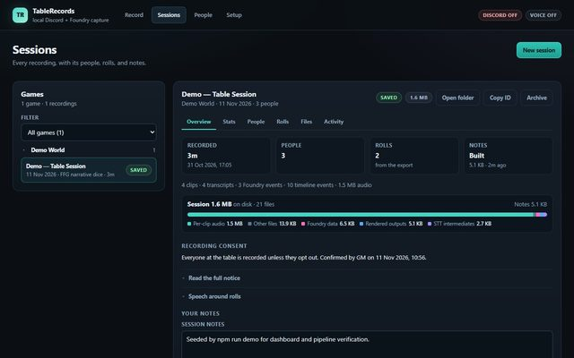
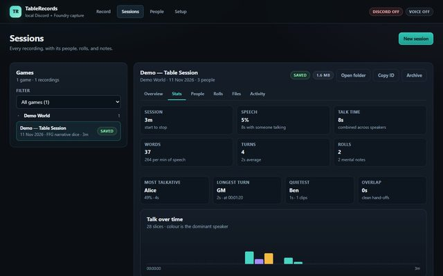
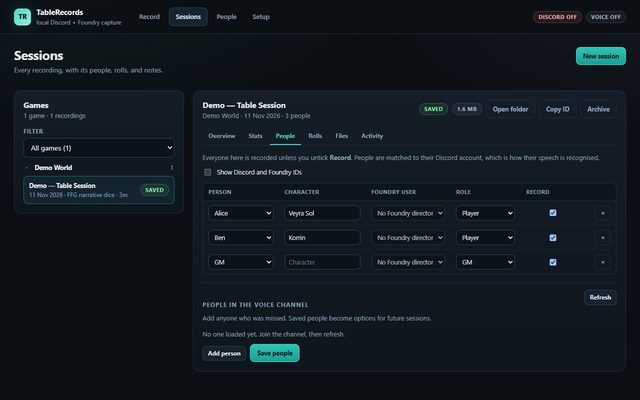
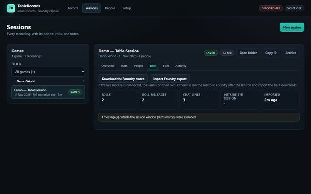
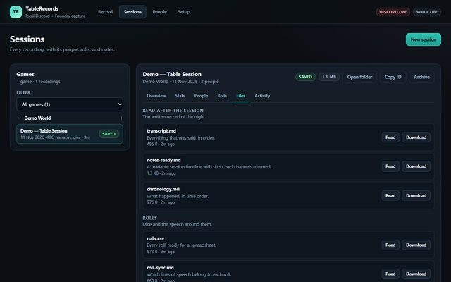
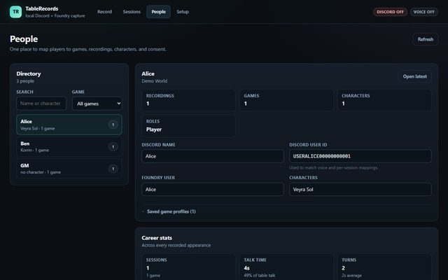

# TableRecords

[](https://github.com/DukeVenator/TableRecords/actions/workflows/ci.yml)
[](https://github.com/DukeVenator/TableRecords/releases)
[](LICENSE)
[](package.json)
[](#requirements)
[](#privacy-and-consent)

I built this for my own table. We play on Discord, run the game in Foundry, and end every night with audio, chat, and rolls but no clean record of what happened. TableRecords is the notebook I wanted: it records each speaker separately, transcribes locally, and gives me a session folder I can use for prep.

It is a solo project, not a hosted service. There is no company behind it and no support queue. It runs on one Windows machine, binds to `127.0.0.1`, and keeps the audio and transcripts there.

## Quick start

TableRecords is available now. The latest builds are on the [Releases page](https://github.com/DukeVenator/TableRecords/releases). Running from source is the full application.

```powershell
git clone https://github.com/DukeVenator/TableRecords.git
cd TableRecords

npm install
Copy-Item .env.example .env
# put a dedicated Discord bot token in .env:
#   DISCORD_TOKEN=...

npm run setup:python
npm run build:web
npm run dashboard
```

Open `http://127.0.0.1:17300`. The first-run wizard checks the bot token, builds the invite link, runs an audio test, and sets up speech-to-text.

To try the pipeline without Discord or a GPU:

```powershell
npm run demo
```

That seeds an FFG session with synthetic audio, a fixture transcript, rolls, markers, mental notes, a timeline, and all seven outputs.

## Screenshots

<table>
  <tr>
    <td width="50%">
      <a href="docs/screenshots/session-overview.jpg"></a>
      <br><sub>Session overview: consent, storage, notes, and build state.</sub>
    </td>
    <td width="50%">
      <a href="docs/screenshots/session-stats.jpg"></a>
      <br><sub>Stats: talk time, turns, rolls, and the quietest player.</sub>
    </td>
  </tr>
  <tr>
    <td width="50%">
      <a href="docs/screenshots/session-people.jpg"></a>
      <br><sub>People: Discord account, character, Foundry user, role, and consent.</sub>
    </td>
    <td width="50%">
      <a href="docs/screenshots/session-rolls.jpg"></a>
      <br><sub>Rolls: imported chat, rolls, and the session window.</sub>
    </td>
  </tr>
  <tr>
    <td width="50%">
      <a href="docs/screenshots/session-files.jpg"></a>
      <br><sub>Files: the readable record and the downloadable outputs.</sub>
    </td>
    <td width="50%">
      <a href="docs/screenshots/demo-people.jpg"></a>
      <br><sub>People directory: everyone across games, with career stats.</sub>
    </td>
  </tr>
</table>

## What it does

TableRecords captures a Discord session per speaker, transcribes each clip, and merges the result with Foundry chat, rolls, scenes, and markers by timestamp. The output is a normal folder of Markdown, CSV, JSONL, and audio. There is no proprietary database to get stuck in.

We recommend the Foundry bridge. It streams chat, rolls, scene and combat state, mental notes, and Break Time into the open session while you play. If you want a lighter setup, or the module cannot connect, use the macro export instead.

The bot is **Scribblespark**, a small automaton who records the session and complains about the fans. Her name and Discord activity are editable in Setup.

See [FEATURES.md](FEATURES.md) for the full list.

## Features

### Capture

- One WAV per speaking burst per Discord user, with absolute timestamps.
- Pauses under 2.4 seconds stay inside an utterance. Silent clips are kept for review but skipped by STT.
- A 60-second capture test before the real session.
- Live speaker list, bytes, utterances, decrypt errors, and last-packet age.
- Break Time starts and ends become break markers through the Foundry bridge.

### Transcription

- **Parrot (Parakeet)** by default, or faster-whisper/Whisper if you prefer.
- CUDA or CPU. Per-user tracks, word timestamps, and transcript JSONL.
- Local only. No cloud transcription.
- Language, model, device, beam size, VAD, and hotwords are settings.
- **Transcribe & brief** processes the last 1, 3, 5, 10, or 15 minutes without an AI provider.

### Foundry bridge

- A live module for chat, rolls, scene and combat state, mental notes, and Break Time.
- First-run wizard for a fresh world: dashboard address, bridge token, connection test, and consent, directory, and Break Time switches.
- GM-only player posts. The dashboard drafts a recap from public material, you edit it privately, then choose **Post to players**. Whispers, blind rolls, and mental notes are excluded.
- FFG narrative dice, SFRPG, and a generic fallback for other systems.
- Live events and the macro fallback deduplicate by message ID.

The macro export is a lighter option and is documented later.

### Sessions and notes

- Record, Sessions, People, and Setup screens.
- Seven outputs: `transcript.md`, `chronology.md`, `rolls.csv`, `roll-sync.md`, `mental-notes.md`, `stats.md`, and `notes-ready.md`.
- Session stats: length, speech coverage, talk time, turns, rolls, per-player share, longest turn, words per minute.
- Review audio: a timestamp-aligned master mix plus per-speaker tracks. Clips can be compacted to 16 kHz mono or deleted after the mix is saved.
- Archive and guarded delete.
- People directory with game, character, role, consent, and career stats.

### AI summaries, optional

- **llama.cpp** with a managed `llama-server`, or **Ollama** as the fallback.
- Local OpenAI-compatible servers and DeepSeek cloud are also selectable. DeepSeek stays off unless you turn on both switches and add a key.
- Recent, scene, and whole-session scopes. Recap, GM prep, clue board, and rules log presets.
- Long sessions split into density-aware portions. Notes, a deterministic roll/marker/person ledger, and a per-portion fact index go to the final prompt.
- GM prep writes four sections separately, then checks people, markers, mental notes, notes headings, and extracted facts. Missing facts get up to three repair passes.
- A floating progress panel shows preparing, portion N of M, reduction, final writing, and done.
- On my 3090, the 35B at 64k context produced a 3-hour-51-minute session in 474 seconds: 3 portions, 12,882 characters, 185 facts checked, no missing facts. The 27B is faster but less stable on full-session runs.
- Summaries are saved under `llm/` and never enter the canonical outputs.

### Privacy and consent

- The consent notice is recorded as an artefact. Opted-out players are never recorded, transcribed, merged, rendered, or summarized.
- No LAN binding, no hosted relay, no cloud transcription.
- AI is off by default and never runs automatically. Only the session brief is sent, never audio.

## Requirements

- Windows 10 or 11.
- Node.js 24 or newer. I use Node 26.
- Python 3.12 for the faster-whisper sidecar.
- A Discord bot token and a private voice channel for the capture test.
- Optional: Foundry VTT 12 to 14 for the bridge.
- Optional: a local model server. The tested deep path is llama.cpp with Qwen3.5 35B-A3B Q4_K_M, 64k context, and `--n-cpu-moe 20`.

## Discord setup

1. Create a Discord application and bot.
2. Enable **Guilds** and **GuildVoiceStates**. Message Content is not needed.
3. Put the token in `.env`.
4. Open **Setup → Discord bot** and use the generated invite link with View Channel, Connect, and Speak.

The bot joins self-deafened=false and self-muted=true. Run the capture test in a private channel before a real session.

## Foundry setup

### Bridge, recommended

We recommend the bridge for live play. It is in [`foundry-module/`](foundry-module/README.md) and is tested on Foundry 14.

1. Open **Setup → Foundry bridge** and enable the bridge.
2. Copy the bridge token.
3. Install the module with the manifest URL below.
4. Enable **TableRecords Bridge** in Foundry and paste the dashboard address and token.
5. Leave the session ID blank to follow the active recording.

```text
https://github.com/DukeVenator/TableRecords/releases/latest/download/module.json
```

The bridge connects to `http://127.0.0.1:17300`. If Foundry runs on another machine, the browser must be able to reach the dashboard over loopback or a tunnel you control.

### Macro fallback

Choose the macro if you want a lighter setup, if the bridge cannot reach the dashboard, or if you want one export after the session.

1. Copy [`foundry-macros/table-records-export.js`](foundry-macros/table-records-export.js) into a Foundry script macro.
2. Run it as GM after the last roll.
3. Open the session, choose the **Rolls** tab, and upload the JSON.

The macro and bridge can both be used. Events deduplicate by message ID.

## Tests and releases

The local suite covers the full code path, including provider and llama.cpp tests:

```powershell
npm run typecheck
npm test
npm run build:web
npm run test:e2e        # dashboard must be running on 127.0.0.1:17300
```

The current suite has **143 tests across 44 files**. Playwright adds 11 browser checks in Edge plus one opt-in live Ollama check. The tests cover WAV writing, voice activity, transcript stitching, Foundry imports and adapters, the macro and module sandboxes, Break Time, consent and opt-outs, merge/render, review audio, output freshness, Parrot and Whisper settings, CSV hardening, job recovery, path safety, session lifecycle, and the summary pipeline.

GitHub Actions does not run model calls. CI runs `npm run test:ci` (121 tests), lint, typecheck, the web build, and the docs check. A `vX.Y.Z` tag starts a release only if CI passes, and the tag must match `package.json`. Bridge tags use `module-vX.Y.Z` and must match `foundry-module/module.json`.

See [docs/RELEASING.md](docs/RELEASING.md).

## Roadmap

TableRecords is one GM, one machine, one active session today. The next work is about letting a table share it without giving up the local-first parts:

- Add accounts and roles so a table can have more than one GM.
- Harden the bridge recording controls with a separate, client-scoped control secret.
- Offer an optional Cloudflare Tunnel and Access front door for remote play.
- Support more than one session and more than one table.
- Add a resource-aware queue for GPU, CPU, and network work.
- Give each GM and player the right view, including per-artifact visibility.
- Create expiring, scoped share links for players.

The full plan is in [ROADMAP.md](ROADMAP.md).

## Commands

| Command | What it does |
|---|---|
| `npm run dashboard` | Run the local server and dashboard |
| `npm run dev` | Watch the server while editing |
| `npm run build:web` | Build the React dashboard into `dist/web` |
| `npm run lint` | Oxlint with warnings denied |
| `npm run typecheck` | TypeScript check |
| `npm test` | Full Vitest suite, including local model paths |
| `npm run test:ci` | Non-LLM suite used by GitHub Actions |
| `npm run test:e2e` | Playwright UI checks in Edge |
| `npm run test:e2e:live` | Opt-in Ollama check (`QA_LLM=1`) |
| `npm run setup:python` | Create or refresh the STT venv |
| `npm run demo` | Seed and process a demo session |
| `npm run doctor` | CLI health report |
| `npm run docs:check` | Score the prose with the avoid-ai-writing detector |

## Docs

- [FEATURES.md](FEATURES.md): the full feature list
- [ROADMAP.md](ROADMAP.md): auth, Cloudflare, multi-table, and sharing plans
- [docs/ARCHITECTURE.md](docs/ARCHITECTURE.md): components and data flow
- [docs/DASHBOARD.md](docs/DASHBOARD.md): UI, API, and state
- [docs/DATA-FORMATS.md](docs/DATA-FORMATS.md): canonical JSONL, SQLite, and session layout
- [docs/FOUNDRY.md](docs/FOUNDRY.md): bridge, macro, and adapters
- [docs/FFG-NARRATIVE-DICE.md](docs/FFG-NARRATIVE-DICE.md): FFG roll structure and vocabulary
- [docs/OPERATIONS.md](docs/OPERATIONS.md): runbook and troubleshooting
- [docs/DISCORD-SETUP.md](docs/DISCORD-SETUP.md): bot invite and voice setup
- [docs/PRIVACY.md](docs/PRIVACY.md): consent, retention, and the AI boundary
- [docs/STT.md](docs/STT.md): Parrot and faster-whisper setup
- [docs/MODELS.md](docs/MODELS.md): model measurements and the 35B setup
- [docs/RELEASING.md](docs/RELEASING.md): CI and release tags
- [docs/VOICE.md](docs/VOICE.md): house voice for UI and docs

## License

AGPL-3.0-only. See [LICENSE](LICENSE).

You can run TableRecords for your own table without publishing anything. If you modify it and run the modified version as a network service, the AGPL requires you to offer that version's source to its users.
